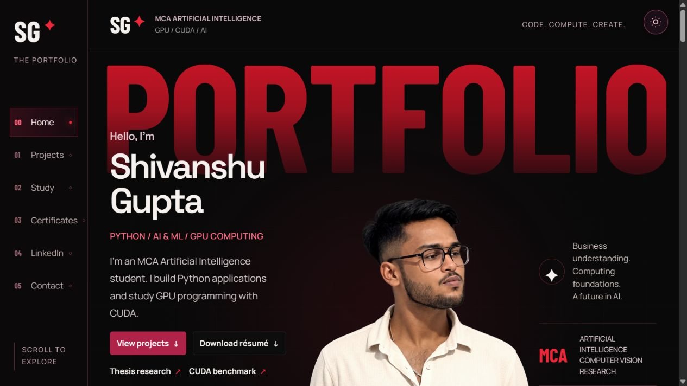

# Shivanshu Gupta | Portfolio

I’m an MCA student focused on applied AI, computer vision, and GPU computing. This portfolio collects my software projects, thesis research, and CUDA experiments.

**[Visit the live portfolio](https://shivanshuguptaportfolio.me/)** · [Résumé and contact](https://shivanshuguptaportfolio.me/#contact) · [Release history](CHANGELOG.md)

[](https://shivanshuguptaportfolio.me/)

## Selected work

| Project | What it does |
| --- | --- |
| [Verdyn](https://shivanshuguptaportfolio.me/#verdyn-case-study) | Compares campus energy and water use from hourly CSV data. |
| [TradeVelocity](https://shivanshuguptaportfolio.me/#tradevelocity-case-study) | A team-built stock order-matching simulator. I worked on matching rules and order-book correctness. |
| [InvenTrack](https://github.com/sgshiv001/inventrack-inventory-management) | A desktop inventory workspace for stock, purchase orders, and CSV imports. |
| [LapCont](https://github.com/sgshiv001/LAPCONT) | An Android-to-Windows remote-control prototype with QR pairing. |
| [NEET Fortress](https://github.com/sgshiv001/NEET-Fortress) | An exam practice and question-bank prototype. |

## Research and experiments

- **Visual pattern matching thesis** explores handwritten digit recognition. The classifier correctly identified 353 of 360 held-out examples. [Read the report (PDF)](src/assets/research/visual-pattern-matching-thesis.pdf)
- **CUDA vector addition** compares CPU time with GPU kernel time and measures how much time data transfers add. [View benchmark results](https://shivanshuguptaportfolio.me/#cuda-benchmark)

## Run locally

The site uses HTML, CSS, and JavaScript. Production runs on a Cloudflare Worker. From the repository root, use Node.js 24.15+ within the 24.x line.

```sh
npm ci
npm run build
npm test
npm run dev
```

Open [http://127.0.0.1:4173/](http://127.0.0.1:4173/). See the [project notes](docs/PROJECT_NOTES.md) for more screenshots, benchmark data, and build and deployment details.
