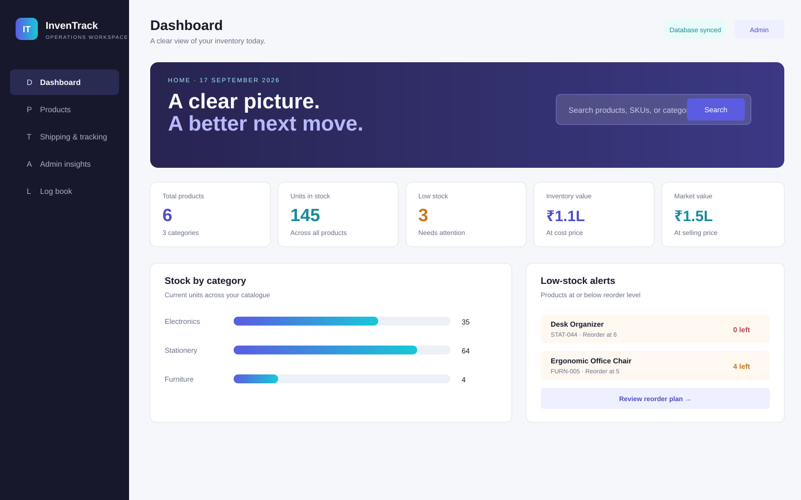
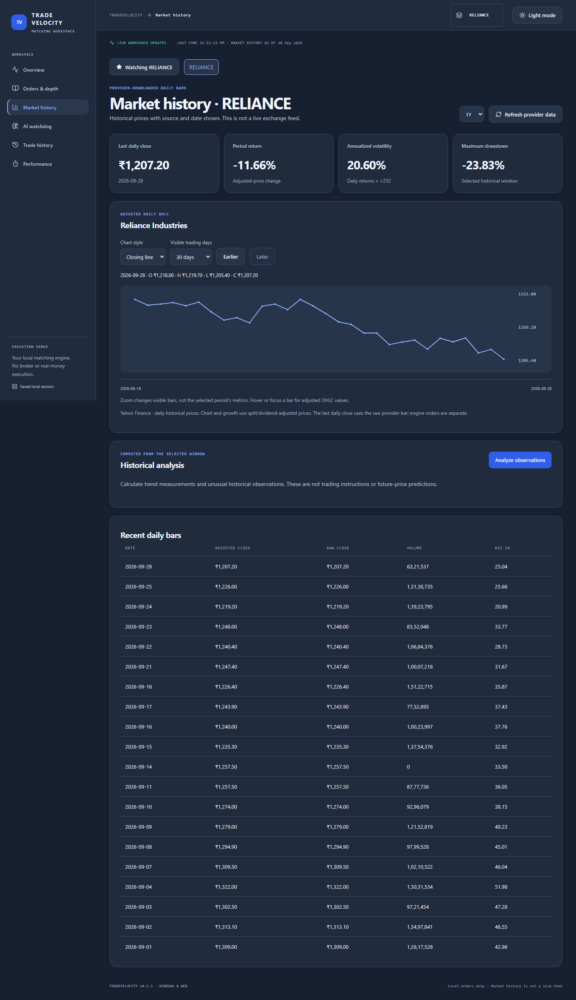
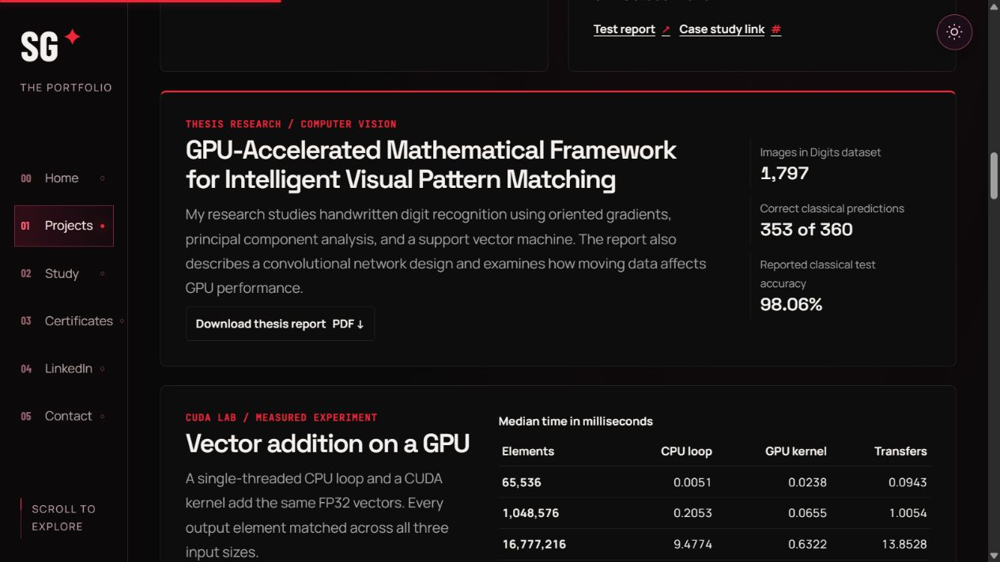

# Shivanshu Gupta | AI, CUDA & Software Portfolio

Shivanshu Gupta’s portfolio brings together applied AI, computer vision research, CUDA experiments, and software projects. The homepage links directly to the project showcase, technical résumé, thesis report, and measured GPU benchmark.

**[Live portfolio](https://shivanshuguptaportfolio.me/)** · [Selected projects](https://shivanshuguptaportfolio.me/#projects) · [Thesis research](https://shivanshuguptaportfolio.me/#thesis-research) · [Contact and résumé](https://shivanshuguptaportfolio.me/#contact)

[](https://shivanshuguptaportfolio.me/)

## Projects

| Project | What it demonstrates |
| --- | --- |
| [Verdyn](https://github.com/sgshiv001/Verdyn-AI-Campus-Digital-Twin) | Campus energy and water comparisons from hourly CSV readings. The median-based workflow supports next-day forecasting after four complete days of readings and flags unusual usage. [Case study](https://shivanshuguptaportfolio.me/#verdyn-case-study) |
| [TradeVelocity](https://github.com/sgshiv001/TRADE-VELOCITY) | Team-built local order-matching application using Python, FastAPI, and React. Shivanshu’s focus was matching rules, fills, cancellations, and order-book correctness. The project recorded 159 passing Python tests and 10 passing browser tests on 1 October 2026. [Case study](https://shivanshuguptaportfolio.me/#tradevelocity-case-study) · [Test report](https://github.com/sgshiv001/TRADE-VELOCITY/blob/main/docs/completion-report.md) |
| [InvenTrack](https://github.com/sgshiv001/inventrack-inventory-management) | Windows inventory workspace built with Electron, Node.js, and SQLite. It includes stock ledgers, purchase orders, and CSV tools. |
| [LapCont](https://github.com/sgshiv001/LAPCONT) | Android-to-Windows remote-control test build using Kotlin, C#/.NET, and Go, with QR pairing and PC session controls. |
| [NEET Fortress](https://github.com/sgshiv001/NEET-Fortress) | Exam practice and paper-assembly prototype built with React, Vinext, and Cloudflare. It includes a question bank and browser-saved attempts. |

| InvenTrack interface preview | TradeVelocity application screenshot |
| --- | --- |
|  |  |

The portfolio carousel supports dragging, swiping, arrow controls, and keyboard navigation. Project details use public GitHub metadata and READMEs, with bundled snapshots available when a live fetch fails.

## Thesis research

**GPU-Accelerated Mathematical Framework for Intelligent Visual Pattern Matching** explores handwritten digit recognition with oriented gradients, principal component analysis, and a support vector machine. The report also describes a convolutional network and discusses the cost of moving data to and from a GPU.

The Digits dataset contains **1,797 images**. The classical pipeline reports **353 correct predictions out of 360 held-out examples**, or **98.06% test accuracy**. The report labels the CNN comparison as simulated. The four-page public research edition presents the methods, findings, and limitations.

[Download the research report (PDF)](src/assets/research/visual-pattern-matching-thesis.pdf)



## CUDA benchmark

The [vector-add experiment](https://shivanshuguptaportfolio.me/#cuda-benchmark) compares a single-threaded CPU loop with a CUDA kernel on an Intel Core i7-14650HX and NVIDIA GeForce RTX 5060 Laptop GPU, using CUDA 13.4 on Windows. Every output element matched at each size.

| FP32 elements | CPU loop (ms) | GPU kernel (ms) | Transfers (ms) |
| ---: | ---: | ---: | ---: |
| 65,536 | 0.0051 | 0.0238 | 0.0943 |
| 1,048,576 | 0.2053 | 0.0655 | 1.0054 |
| 16,777,216 | 9.4774 | 0.6322 | 13.8528 |

Each value is the median of 21 samples after five warm-ups. CUDA events time the kernel. The transfer column includes both input uploads and the result download using pinned host memory. Allocation is outside the timed runs. At the largest input size, transfers alone took longer than the CPU loop.

The [CUDA source](src/assets/cuda/vector-add.cu) is separate from the website build. With the CUDA Toolkit and a supported host compiler, build and run it from the repository root on Windows. Use the architecture flag that matches your GPU.

```powershell
nvcc -O3 -arch=sm_120 src/assets/cuda/vector-add.cu -o vector-add.exe
.\vector-add.exe
```

## Images and assets

| Location | Contents |
| --- | --- |
| [`docs/images/`](docs/images/) | Live website screenshots used in this README. They sit outside the site build. |
| [`src/assets/`](src/assets/) | Editable site assets, including responsive WebP portraits, font files and licenses, the research PDF, and résumé PDFs. |
| [`src/assets/projects/`](src/assets/projects/) | Project images, including the TradeVelocity application screenshot, InvenTrack interface previews, and NEET Fortress banner artwork. The portfolio labels previews and artwork alongside application screenshots. |
| [`src/assets/certificates/`](src/assets/certificates/) | Image of the Google Foundations of Cybersecurity course completion certificate. [Verify on Coursera](https://www.coursera.org/account/accomplishments/verify/BCR0WHSA0QHW) |

## Run locally

Use **Node.js 24.15.0 or newer in the 24.x line** and npm.

```bash
git clone https://github.com/sgshiv001/MY-PORTFOLIO-WEBSITE.git
cd MY-PORTFOLIO-WEBSITE
npm ci
npm run build
npm test
npm run dev
```

Open [http://127.0.0.1:4173/](http://127.0.0.1:4173/). Build again after changing the source and restart the preview to load the new Worker. On Windows PowerShell, use `npm.cmd` if execution policy blocks the npm script shim.

## Repository layout

| Path | Role |
| --- | --- |
| [`src/`](src/) | HTML, CSS, browser JavaScript, public project snapshots, and site assets. |
| [`worker/`](worker/) | HTTP routing for the production Cloudflare Worker. Shared headers are defined in [`security-headers.mjs`](security-headers.mjs). |
| [`public-site/`](public-site/) | Generated browser export with copied assets, minified bundles, and content-hashed filenames. |
| [`dist/`](dist/) | Sites deployment package. The generated Worker in `dist/server/index.js` embeds the allowlisted browser files. |
| [`tests/`](tests/) | Browser behavior and Worker response checks, including asset integrity, security headers, caching, and PDF range requests. |

Edit assets in `src/` and rebuild to regenerate `public-site/` and `dist/`. Commit the source change and its generated outputs together. For documentation-only changes, `git diff --exit-code -- public-site dist` checks that rebuilding produces the same tracked files.

## Deployment and site behavior

The production site runs as a Cloudflare Worker on Sites. The [hosting manifest](.openai/hosting.json) holds the Site project ID. The custom domain is managed in Sites. The Worker serves the bundled assets over HTTPS and sets the security headers described in [`SECURITY_NOTES.md`](SECURITY_NOTES.md).

The theme follows the visitor’s device and supports a manual override. Animations respect the device’s reduced-motion setting. The contact form opens an email draft for the visitor to review and send.
